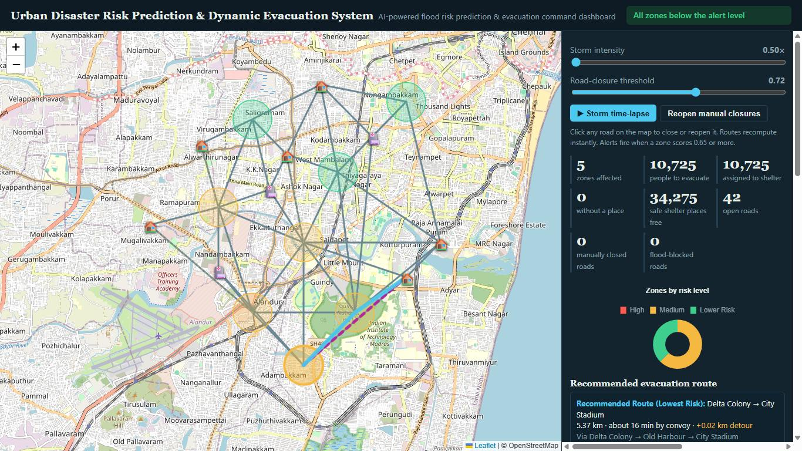
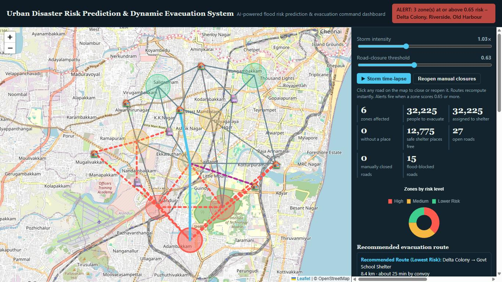
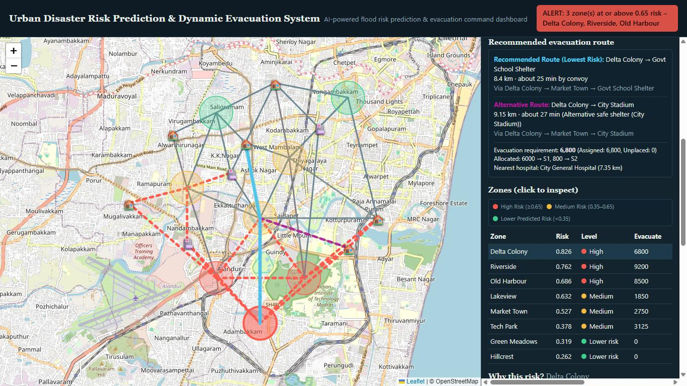
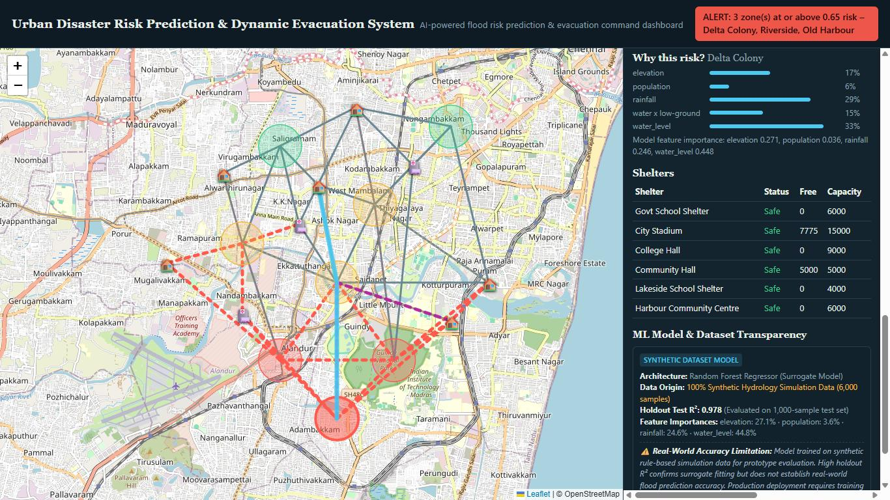
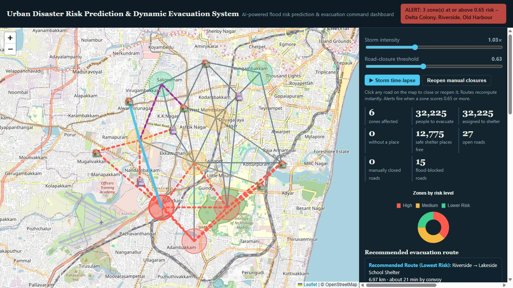

# AI-Based Urban Disaster Risk Prediction & Dynamic Evacuation System

AI-assisted flood risk assessment and dynamic evacuation planning dashboard.
Built by **Team Tech Spark** for the **ARCOVA Hackathon, ARTIWHIZ 2026** (AI in Smart Cities).


## Problem

During heavy rainfall, urban roads flood and access to hospitals and shelters is cut off.
Fixed risk maps and predefined evacuation routes do not adapt when conditions change, and
risk assessment and route planning are often handled in separate tools.

## Solution

A single web dashboard that estimates flood risk for each city zone, detects unsafe roads,
and recalculates risk-aware evacuation routes to safe shelters with available capacity.

## Features

- **AI risk prediction:** Random Forest model scores each zone (0 to 1) and classifies it as Low, Medium or High risk
- **Explainable scores:** shows how rainfall, water level, elevation and population contribute to each zone's risk
- **Risk alerts:** warning when a zone crosses the High-risk threshold
- **Road safety analysis:** flags manually closed roads, roads marked blocked in the data, and flooded low-lying roads
- **Dynamic evacuation routing:** Dijkstra's algorithm with risk-weighted costs, blocked roads excluded
- **Shelter allocation:** unsafe shelters are excluded, capacity limits are respected, unplaced evacuees are tracked
- **Hospital accessibility:** identifies the most accessible hospital through the open road network
- **Interactive simulation:** storm intensity slider, road-closure threshold, manual road close/reopen
- **Command dashboard:** Leaflet map plus Chart.js charts and evacuation statistics

## How It Works

```
city.json  ->  Random Forest risk score  ->  Low / Medium / High
           ->  unsafe roads removed      ->  Dijkstra to safe shelters
           ->  shelter allocation        ->  dashboard + alerts
```

| Component | File |
|-----------|------|
| Sample city data (8 zones, 6 shelters, 3 hospitals, 42 road links) | `data/city.json` |
| ML model (Random Forest Regressor) | `model.py` |
| Backend logic, routing, allocation, API (`/api/state`) | `app.py` |
| Dashboard UI | `static/index.html` |
| Tests | `test_app.py` |

Risk levels: **Low** below 0.35, **Medium** from 0.35 to below 0.65, **High** at 0.65 or above.

## Tech Stack

Python, Flask, scikit-learn, NumPy, Leaflet, Chart.js, HTML/CSS/JavaScript

## Run Locally

```bash
git clone https://github.com/ilamaran5648-Professional/ai-urban-disaster-evacuation-system.git
cd ai-urban-disaster-evacuation-system
python -m venv venv
venv\Scripts\activate          # Windows
# source venv/bin/activate     # macOS / Linux
pip install -r requirements.txt
python app.py
```

Open http://127.0.0.1:5000 in your browser.

## Demo Steps

1. Open the dashboard and inspect the city risk map.
2. Increase the storm intensity and watch the risk scores change.
3. Adjust the road-closure threshold.
4. Manually close a road and watch the routes recalculate.
5. Select a zone to see its risk level and evacuation route.

## Run Tests

```bash
python -m unittest -v
```

## Screenshots

**Normal conditions:** all zones below the alert level


**High storm intensity:** risk alert, flood-blocked roads (red dashed) and a recommended route


**Zone table and evacuation plan:** primary and alternative routes, shelter allocation, nearest hospital


**Explainability and model transparency:** why a zone is high risk, shelter status, model limitations


**Dynamic rerouting:** the route changes when conditions or road closures change


## Limitations

- Uses sample city data. No live weather, water-level or traffic feeds.
- The model is trained on 6,000 synthetic samples labelled by a predefined scoring rule with added noise, so it is a surrogate model.
- Predictions have not been validated against real flood events.

## Future Scope

- Live weather API and IoT water-level sensors
- Real road networks from OpenStreetMap
- Training on real flood-history data
- Satellite imagery and real-time population data
- Cloud deployment

## Team

**Team Tech Spark** (Perunthalaivar Kamarajar Institute of Engineering and Technology, Information Technology)

- S. Sumithraj
- R. Ilamaran
- M. Rajasree

## Acknowledgements

Problem statement by the Department of Artificial Intelligence and Data Science,
ARCOVA Hackathon, ARTIWHIZ 2026, E.G.S. Pillay Engineering College.
